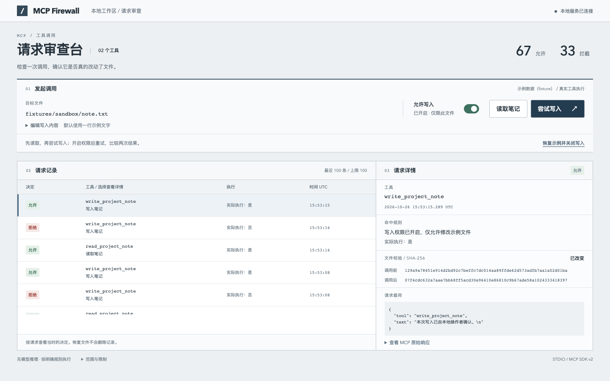
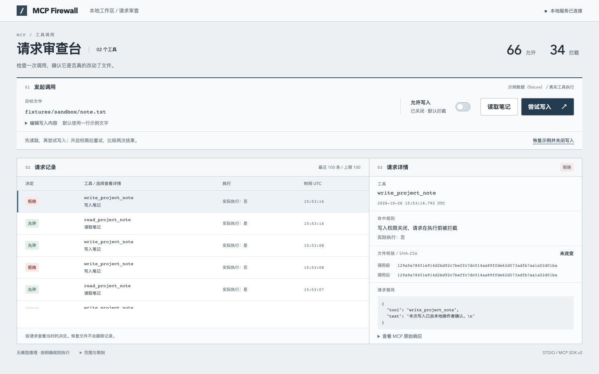

# 使用手册 · MCP Firewall

给正在接入 MCP 工具的开发者：在本地试一次读写，看看写入权限关闭时请求在哪里被拦住，开启后文件是否真的改变。



界面中的记录来自官方 MCP SDK 启动的 stdio 工具进程。没有模型、账号或 API Key；操作对象是仓库内的一份示例笔记。

## 启动

需要 Node.js **22.12+（22 系列）、24.x 或 26+**，以及 npm。进入本项目目录执行：

```sh
npm ci --cache .npm-cache
npm run dev
```

打开 [本地审查台](http://127.0.0.1:4205)。前端使用 4205 端口，API 使用 5205；两者只监听 `127.0.0.1`。停止服务时在终端按 Ctrl+C。

想连浏览器测试环境一起安装，可用 `npm run setup` 替代第一条命令。它安装锁定的 npm 依赖、Chromium 无头浏览器和 FFmpeg；下载缓存与临时文件都放在项目目录。首次安装需要联网，浏览器下载较大。

Windows PowerShell 如果阻止 `npm.ps1`，请改用 `npm.cmd`。Linux 上的 Chromium 可能还需要系统库；脚本不会自动安装系统软件。

## 试一次被拒绝的写入

1. 点击“读取笔记”，确认出现一条已执行的读取记录。
2. 保持写入开关关闭，点击“尝试写入”。选中这条请求，可以看到拒绝规则、未执行标记，以及相同的前后哈希。
3. 开启“允许写入”，再次尝试。文件会被更新，详情显示“已改变”。可展开“编辑写入内容”修改示例文字。
4. 点击“恢复示例并关闭写入”，回到初始笔记和默认权限。已有记录保留，便于对照。



点击表格里的工具名可以检查不同请求。当前页面发出的请求会临时保留载荷、响应和哈希；刷新后这些正文消失，历史日志只留下时间、工具、规则和执行结果。详情展示的是调用发生时的证据，不是文件此刻的内容。

## 检查环境与运行测试

先停止 dev，再运行诊断，避免本项目自己占用端口：

```sh
npm run doctor
npm run browsers:install
npm run build
npm run test
npm run e2e
npm run demo
```

`doctor` 不依赖第三方包，检查 Node 版本、依赖、浏览器、录像组件和两个端口，缺项时给出中文修复命令。`browsers:install` 只在缺少测试浏览器时需要；运行界面无需安装它。

测试覆盖真实 SDK 读写、拒绝后文件不变、授权后文件改变、请求详情对应、API 参数校验、390px 无横向溢出、键盘焦点，以及加载、空记录和错误反馈。空记录与 HTTP 错误测试使用明确的模拟响应；读写演示使用真实工具。`npm run demo` 会重新拍摄 README 图片并生成录像。

`npm run mcp:demo` 可直接在终端运行同样的 SDK 流程。请勿与界面操作或其他测试同时执行。

如果环境已经有兼容 Chromium，可复用它：

```sh
# macOS / Linux：替换为实际可执行文件
export PLAYWRIGHT_EXECUTABLE_PATH="/实际路径/chrome-headless-shell"
npm run doctor
npm run e2e
```

```powershell
# Windows PowerShell
$env:PLAYWRIGHT_EXECUTABLE_PATH = 'C:\实际路径\chrome-headless-shell.exe'
npm run doctor
npm run e2e
```

默认浏览器缓存目录是 `.playwright-browsers`，也可设置 `PLAYWRIGHT_BROWSERS_PATH` 指向包含匹配 FFmpeg 的缓存。`.env.example` 仅说明变量，项目不会自动加载 `.env`。

端口冲突时停止原服务；依赖不完整时重新执行 `npm ci --cache .npm-cache`；连接失败时检查 [API 健康地址](http://127.0.0.1:5205/api/health)。文件操作失败时检查 `fixtures/sandbox/note.txt` 是否存在、可读写且不是符号链接。

## 当前边界

只提供 `read_project_note` 和 `write_project_note`，目标固定为 `fixtures/sandbox/note.txt`，写入最多 2,048 字符。不开放任意路径、命令行或网络工具，也不是通用 MCP 拦截器。权限检查发生在工具内部、文件操作之前。

这是单用户本地演示。日志是可修改的 JSON，最多保留 100 条，没有跨进程锁或防篡改能力。服务重启后写入权限关闭，日志保留。它不是操作系统沙盒或身份认证系统，无法防御恶意本地进程及文件系统竞争攻击。

本次在 macOS / Node 26.4 上验证，复用已有 Chromium 和项目内 FFmpeg。全新 setup 下载、Windows、Linux 和其他支持的 Node 版本尚未实机验证。

## 项目结构

React 负责界面，Vite 代理本地 API，Express 推送请求状态；官方 MCP client/server 运行 stdio 调用，Zod 校验参数。TypeScript / tsx 用于构建和执行，Vitest / Playwright 用于集成测试、浏览器测试和录像。精确版本见 `package-lock.json`。

- `src/`：操作区、请求表和详情面板。
- `server/`：API、MCP 工具与文件存储。
- `scripts/`：安装和环境诊断。
- `docs/images/`：实际应用截图，随仓库提交。
- `artifacts/`：本地日志和录像，不提交 Git；验证记录见 `status.json`。

许可证：[MIT](../LICENSE)。
